<p align="center"></p>

# 🌿 Smart Demetra — automação de cultivo indoor (ESP32-S3)

Controla a **luz**, a **ventilação**, a **umidificação**, o **aquecimento**, a **irrigação** e a **trava da porta** de uma estufa. Mede **temperatura, umidade, solo, VPD e o nível da caixa d'água**, avisa pelo **Telegram** quando algo sai da faixa e mostra tudo num **painel web** que funciona no computador e no celular.

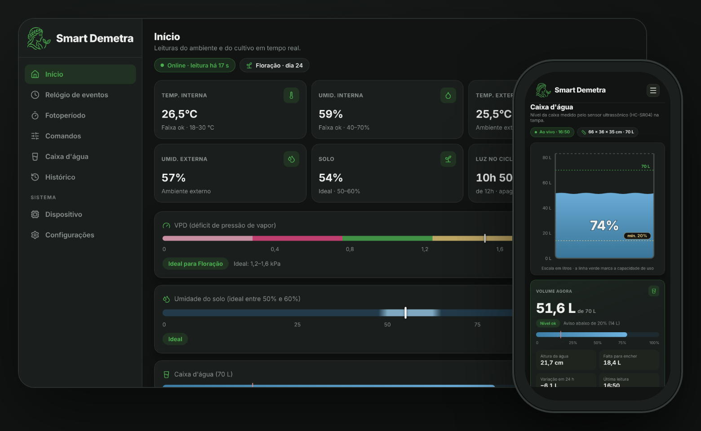

> **Versão atual:** painel v2 · firmware **v2.9.0** · banco com migrações automáticas até a `009`.

---

## O que o projeto faz

- 💡 **Luz automática por fase** — Vegetação 18/6 h ou floração 12/12 h. Você escolhe só a hora em que a luz acende, e o ESP32 confirma o horário em uso.
- 🌱 **Ciclo de cultivo** — Conta o dia do ciclo e troca de fase na hora ou numa data programada.
- 🌡️ **Monitoramento** — Temperatura e umidade dentro e fora da estufa, umidade do solo (sensor capacitivo) e VPD avaliado pela fase ativa, gravados a cada minuto.
- 🪣 **Caixa d'água** — Nível medido por um HC-SR04 na tampa, em litros e percentual dos 70 L, com aba própria no painel, aviso de nível baixo e **proteção da bomba**: abaixo de 10% a irrigação é desligada e bloqueada.
- 🔔 **Avisos no Telegram** — Leitura fora da faixa, caixa d'água baixa, dispositivo offline, timer não confirmado e resumo diário às 08:00.
- 🌀 **8 relés** — Luz, irrigação (relé 1), ventilador, umidificador (relé 3), entrada de ar, aquecedor, saída de ar e trava da porta. O ESP32 informa o estado de todos ao ligar.
- 💨 **Clima por VPD** — Você escolhe a fase (muda, vegetação ou floração), e o umidificador mantém o VPD sempre dentro da faixa: liga antes do máximo e desliga antes do mínimo, sem liga/desliga curto e com trava de umidade. Funciona sem internet ([detalhes](#clima-por-vpd)).
- ⚡ **Painel ao vivo** — O ESP32 manda o estado atual (leituras e relés) a cada 5 s, e o painel mostra sem recarregar, só com a Hostinger ([detalhes](#painel-ao-vivo)).
- 🔐 **Acesso seguro** — Várias contas com código de convite, limite de tentativas e token próprio para o ESP32.
- 📶 **Configuração sem cabo** — Portal Wi-Fi **SmartDemetra-Setup** para escolher a rede e vincular o aparelho ao painel.
- 🖥️ **Uso local** — Display OLED e botões no aparelho, que continuam funcionando sem internet.
- 🔋 **Sem perder estado** — Relés, fase, horários e duração do modo manual ficam na memória do relógio (RTC), mesmo se faltar energia.

---

## Como funciona

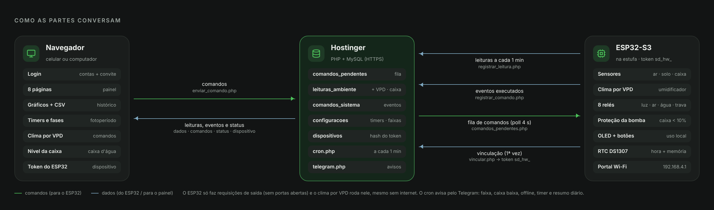

1. O **ESP32** lê os sensores e envia uma leitura por minuto para o servidor na **Hostinger**, identificado pelo seu **token do hardware**. Essa é a leitura que fica no histórico.
2. A cada **5 segundos** o ESP32 também manda o **estado atual** (leituras, fase, luz e relés). O servidor guarda só o último, e o painel mostra ao vivo.
3. No **painel**, cada ação grava um comando numa **fila** no banco de dados.
4. O ESP32 consulta essa fila a cada **4 segundos**, aplica o comando e confirma de volta, e o painel mostra se a confirmação chegou.
5. Um **cron** roda no servidor a cada minuto. Ele faz as trocas de fase programadas e envia os avisos do Telegram.

O ESP32 só faz conexões de saída, então não é preciso abrir portas no roteador e o painel funciona de qualquer lugar. Toda a rede roda numa tarefa própria no **núcleo 0** do ESP32-S3, com a conexão HTTPS reaproveitada entre as requisições. O `loop()` (sensores, relés, OLED, botões e clima por VPD) fica no núcleo 1 e nunca espera o servidor.

---

## O painel

### Início
Mostra as leituras atuais com a faixa ideal de cada card e o selo **Online/Offline** com o tempo da última leitura. O selo da fase indica o **dia do ciclo**. O card **Luz no ciclo** mostra há quanto tempo a luz está acesa. O VPD é comparado com a faixa da fase ativa, e o solo tem a faixa ideal marcada.
Se o ESP32 parar de enviar, aparece o aviso de offline com a hora da última leitura. Se o sensor de solo (capacitivo) ou o da caixa d'água não responder três vezes seguidas, a barra mostra **"Sensor sem leitura"**. A barra da **caixa d'água** mostra litros, percentual dos 70 L e quantos centímetros de água há, e fica em alerta abaixo do nível configurado.

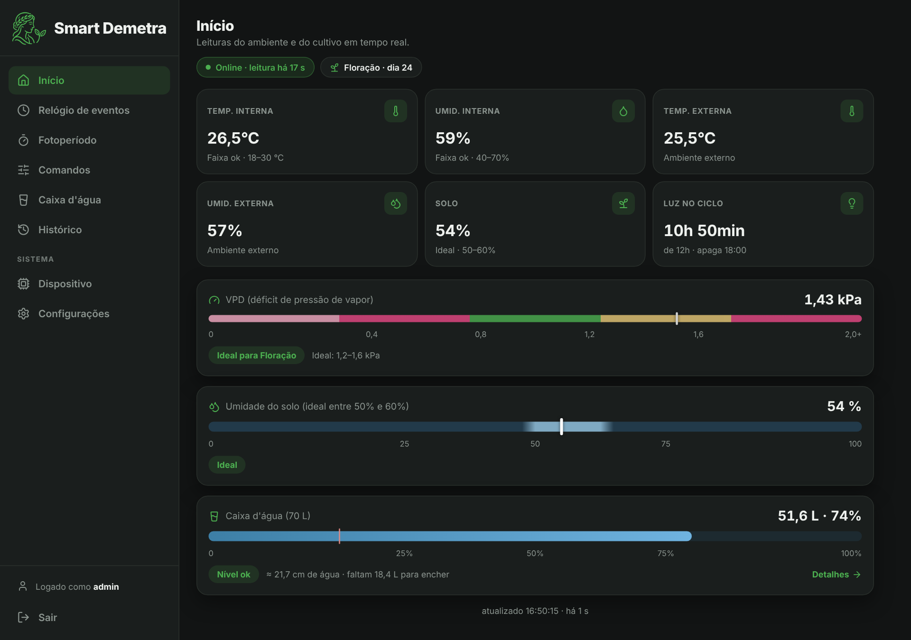

### Relógio de eventos
As últimas 24 horas num relógio. A faixa de luz segue o fotoperíodo da fase ativa (18/6 na vegetação, 12/12 na floração). O aquecedor e o umidificador têm anéis próprios: cada trecho pintado é um período ligado, com o VPD no início e no fim. No umidificador, o detalhe mostra a regra do clima por VPD e o motivo de cada ação (ponto de ligar, ponto de desligar, borda da faixa ou trava), com a leitura do sensor naquele momento. Porta, avisos, trocas de fase e ajustes das automações aparecem como pontos. No topo, um resumo das 24h que também filtra; embaixo, a lista separada em Hoje e Ontem.

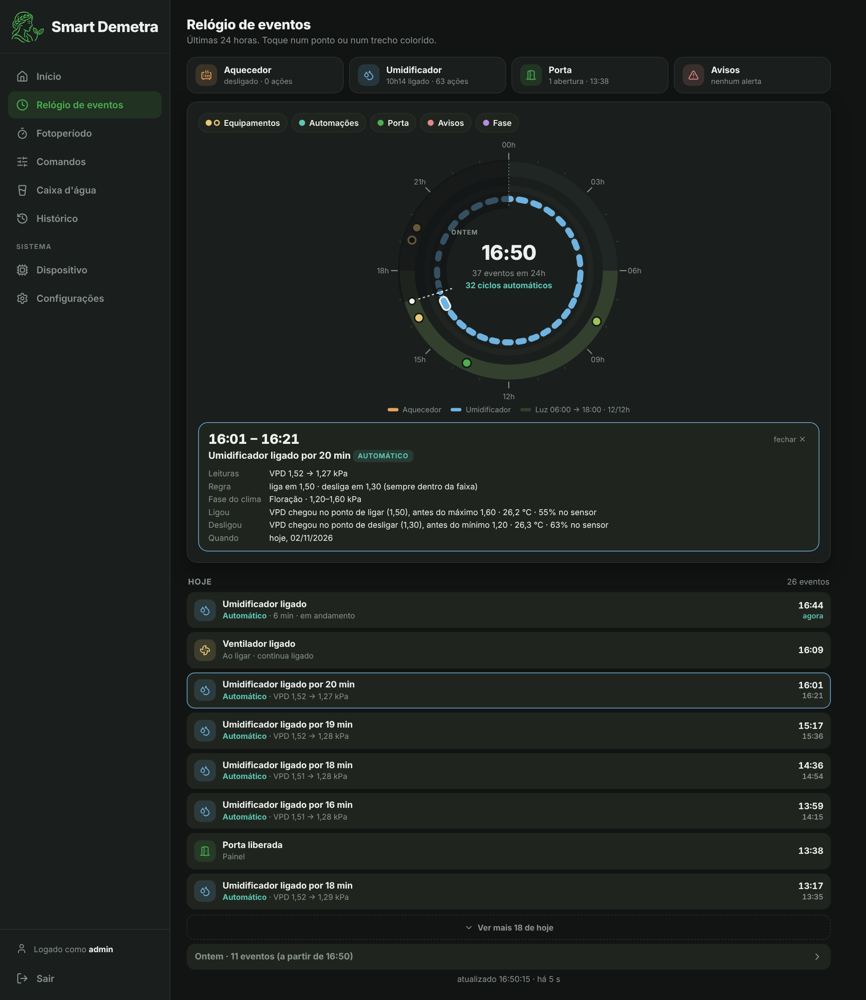

### Fotoperíodo
É a central dos timers e da fase:

- **Quatro cards de resumo:** fase ativa com o dia do ciclo, luz agora, próxima mudança e **Timer no ESP32**. Este último mostra se o timer está confirmado, aguardando ou divergente.
- **Card de cada fase:** você escolhe a hora em que a luz acende, e a hora de apagar é calculada mantendo 18/6 ou 12/12.
- **Fase inativa:** tem a seção **Troca de fase**, para ativar agora ou programar uma data. A troca acontece no primeiro horário de luz desse dia.

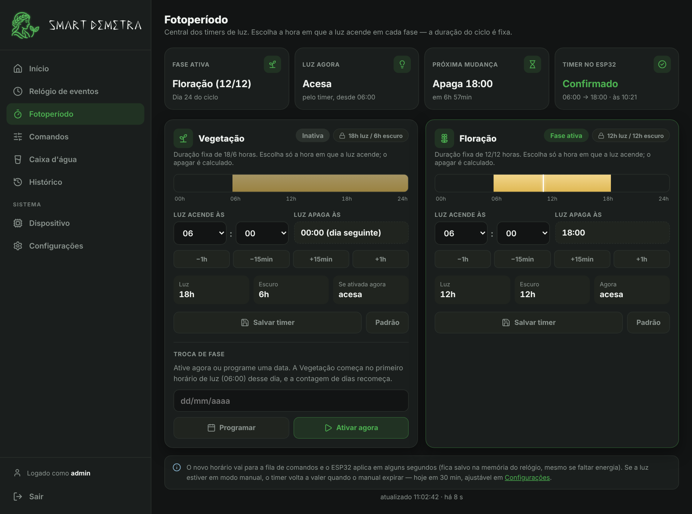

### Caixa d'água
Nível da caixa ao vivo, medido pelo HC-SR04 na tampa: desenho da caixa em escala de litros com a linha de 70 L e a do aviso mínimo, volume atual, altura da água, quanto falta para encher, variação em 24 h e o gráfico das últimas 24 horas. Abaixo de 10% a irrigação fica bloqueada para proteger a bomba.

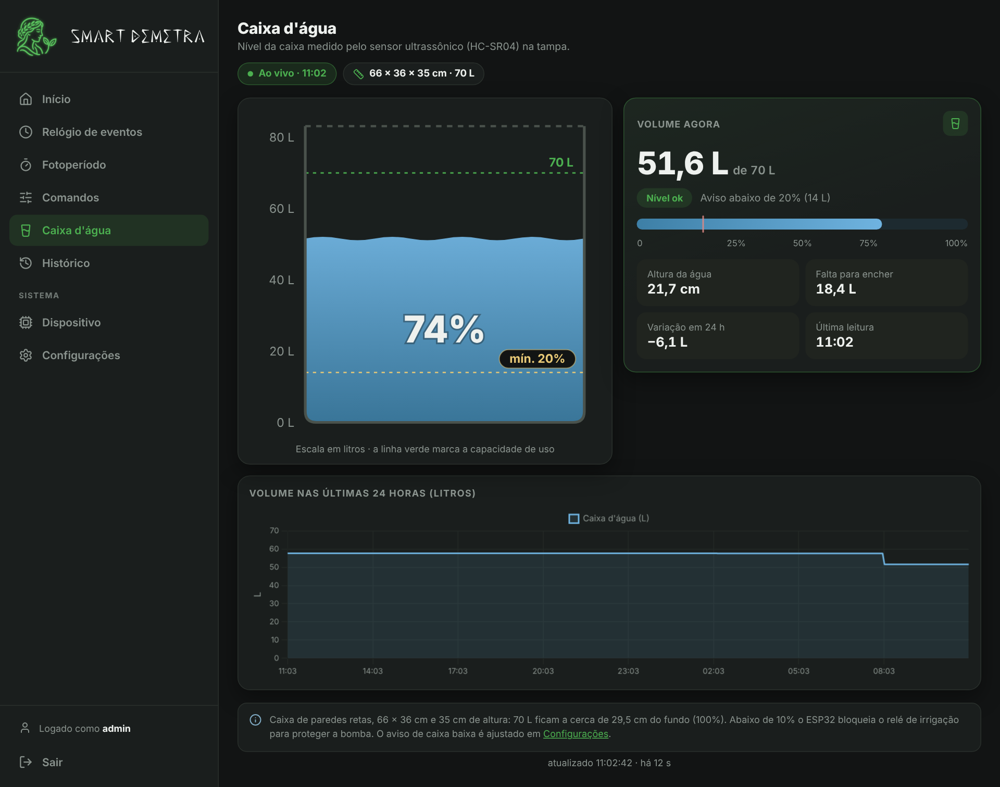

### Comandos
Modo de cultivo, clima por VPD (fase, medidor do VPD atual com os pontos de ligar e desligar, estado do umidificador, faixa, trava e tempo mínimo), luz automática ou manual, liberação da porta e interruptores dos relés. Cada interruptor mostra o estado real e há quanto tempo está assim. Um comando manual no umidificador pausa o clima por VPD. Com a caixa d'água abaixo de 10%, o card da irrigação aparece como **Bloqueada**. A troca de fase fica no Fotoperíodo.

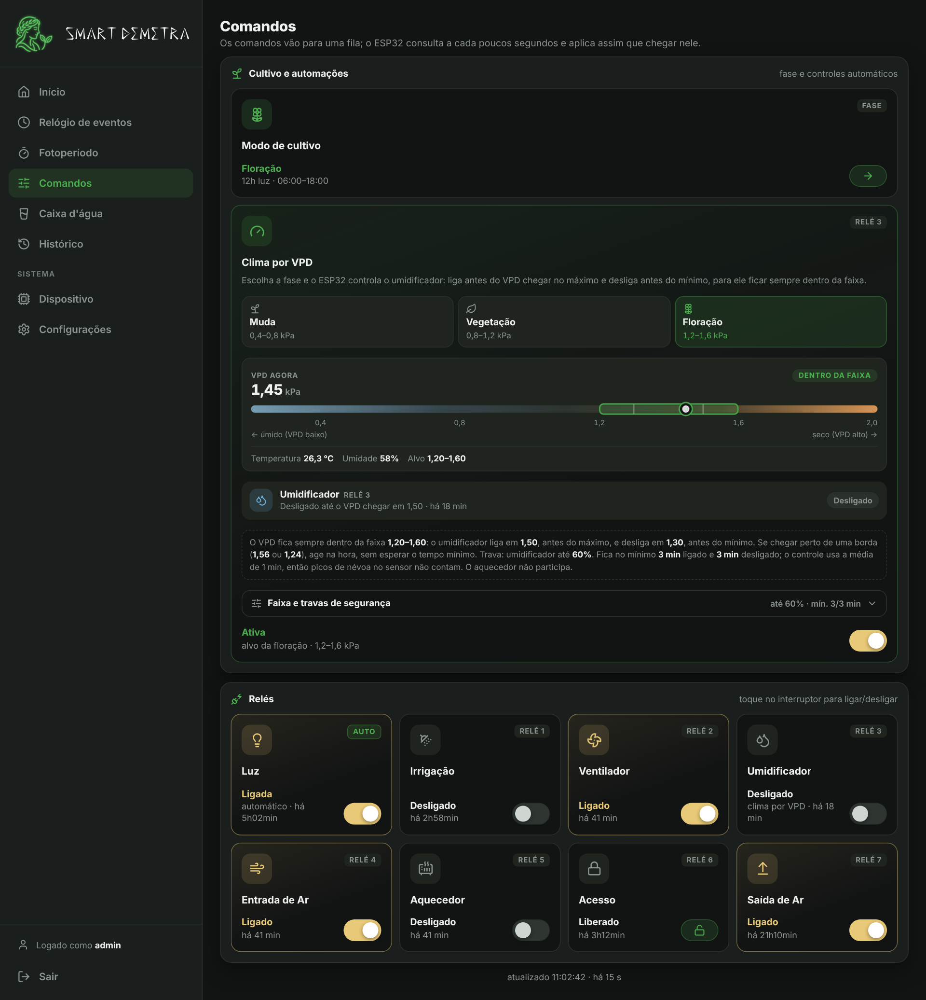

### Histórico e VPD
Gráficos de temperatura, umidade, solo e **VPD** em 24 h, 7 dias ou 30 dias. O botão **Exportar CSV** baixa o período escolhido, com o estado da luz. O CSV usa `;` e vírgula decimal e abre direto no Excel em português.

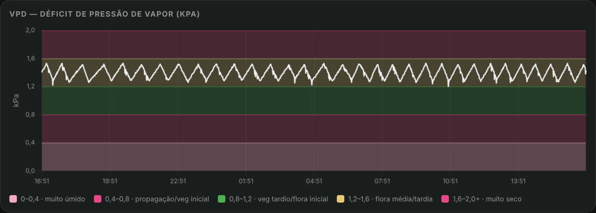

| VPD (kPa) | Zona | Cor |
|---|---|---|
| < 0,4 | Muito úmido (risco de fungo) | Rosa fraco |
| 0,4 – 0,8 | Propagação / vegetativo inicial | Rosa forte |
| 0,8 – 1,2 | Ideal na vegetação (padrão) | Verde |
| 1,2 – 1,6 | Ideal na floração (padrão) | Amarelo |
| > 1,6 | Muito seco (estresse hídrico) | Rosa forte |

As faixas ideais de cada fase podem ser ajustadas em Configurações.

### Dispositivo
- **Status do ESP32:** modelo, MAC, firmware, último contato, sinal Wi-Fi e tempo ligado.
- **Token do hardware:** o banco guarda só o hash, e o token completo aparece uma única vez. Os botões **Gerar novo** e **Revogar** pedem confirmação.
- **Vincular novo dispositivo:** gera um código de uso único, válido por 30 min, para colar no portal Wi-Fi do ESP32.
- **Atividade recente:** timer confirmado, reconexões, reinícios, troca de firmware e sensor de solo.

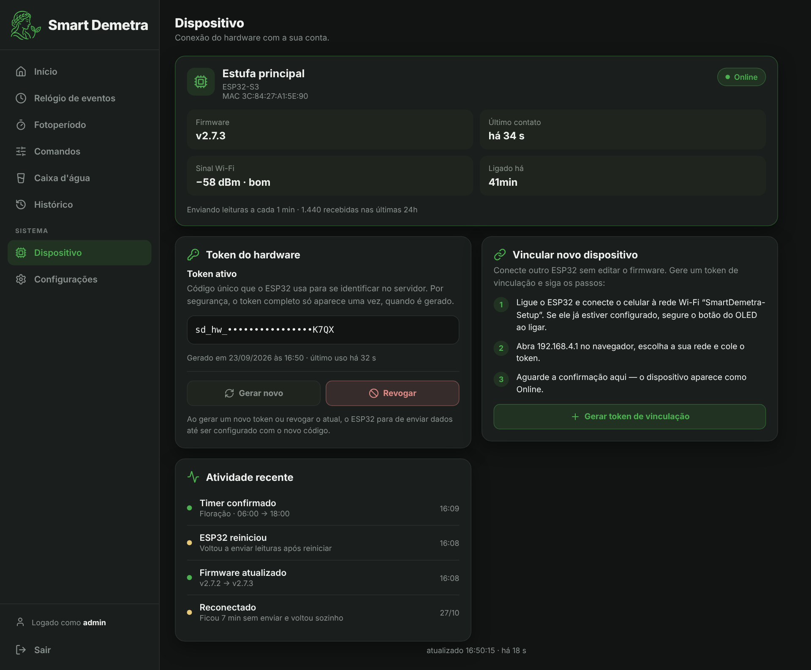

### Configurações
- **Painel:** nome do cultivo, página inicial, atualização automática (5, 10 ou 30 s, ou 1, 2, 5 ou 10 min; padrão 5 s) e período padrão do histórico. Cada atualização é leve: o painel pergunta ao `ao_vivo.php` o que mudou e só busca leituras novas ou eventos quando há algo novo. A carga completa acontece ao abrir, depois de ações e a cada 5 min.
- **Faixas de alerta:** solo, temperatura e umidade interna (mínimo e máximo), VPD ideal por fase (a mesma faixa usada pelo clima por VPD), alerta da caixa d'água (padrão 20%) e o tempo para considerar o dispositivo sem dados. O servidor valida tudo e aceita vírgula decimal.
- **Notificações:** conexão com o Telegram, mensagem de teste e os quatro interruptores de aviso.
- **Luz:** duração do modo manual (15, 30, 60 ou 120 min). O valor é enviado ao ESP32, e o painel mostra quando ele aplicou.
- **Conta e usuários:** troca de senha. O administrador também gerencia o código de convite e as contas.

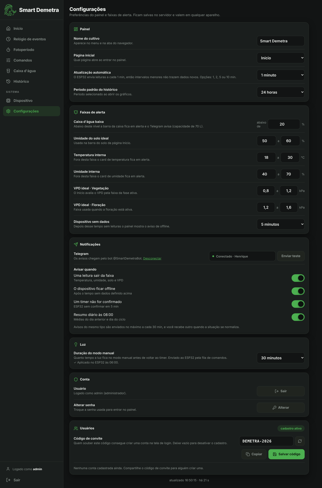

### No celular
O mesmo painel se adapta à tela do celular, com o menu recolhido no botão ☰.

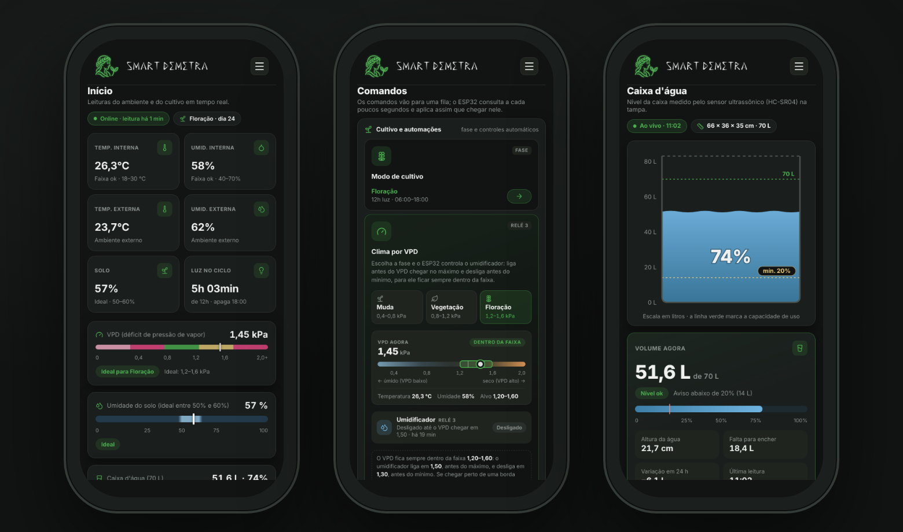

---

## Notificações pelo Telegram

| Aviso | Quando chega |
|---|---|
| Leitura fora da faixa | Temperatura, umidade, solo ou VPD saem da faixa (avaliado a cada leitura) |
| Caixa d'água baixa | O nível fica abaixo do alerta configurado (padrão 20%); avisa de novo ao reabastecer |
| Dispositivo offline | Passou o tempo de "Dispositivo sem dados" sem leituras |
| Timer não confirmado | O ESP32 não confirmou o timer da fase ativa em 5 min, ou usa um horário diferente |
| Resumo diário | Às 08:00: médias do dia anterior, nível da caixa d'água e dia do ciclo (desligado por padrão) |

Cada tipo de aviso chega no máximo uma vez a cada 30 min. Quando a situação volta ao normal, chega um aviso de **"normalizado"**. Todos os envios ficam registrados no Relógio de eventos.

Para conectar: crie um bot no **@BotFather** e coloque o token no `config.php`. Depois clique em **Configurações → Notificações → Conectar**, abra o link no celular e toque em **Iniciar**.

---

## Acesso e contas

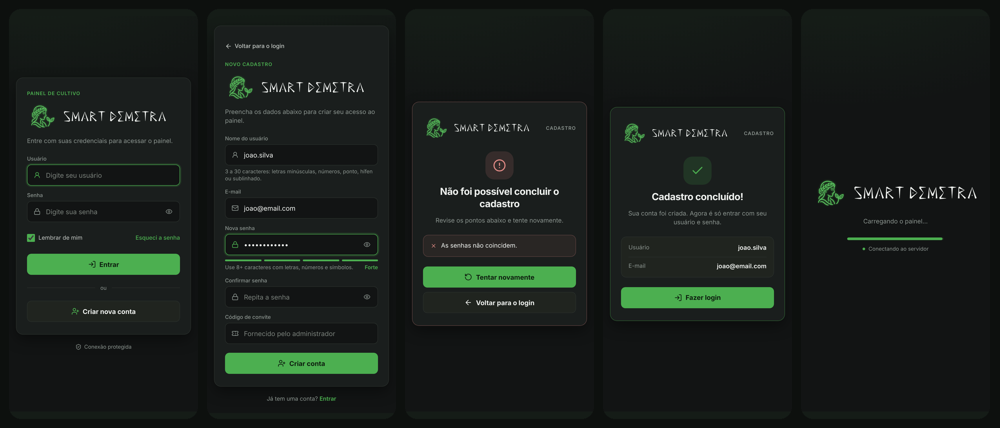

- **Login** com usuário ou e-mail e a opção **Lembrar de mim**, que vale 30 dias.
- **Cadastro** protegido por **código de convite**, que o administrador gera em Configurações → Usuários. Sem código, ninguém consegue se cadastrar.
- **Administrador principal:** é o usuário do `config.php`. No primeiro acesso ele vira uma conta no banco, e a senha pode ser trocada no painel. Se esquecer a senha, gere um hash novo no `config.php`: ele volta a valer.
- **Esqueci a senha:** o administrador gera uma senha temporária, e a pessoa troca depois em Configurações.
- **Alterar senha** desconecta os outros aparelhos, inclusive os que usam "Lembrar de mim".
- **Limite de tentativas:** 5 erros para o mesmo usuário, ou 20 erros de um mesmo IP, bloqueiam novas tentativas por 15 minutos.
- Os formulários são protegidos contra CSRF, e as senhas e tokens ficam só como hash no banco.

---

## Hardware

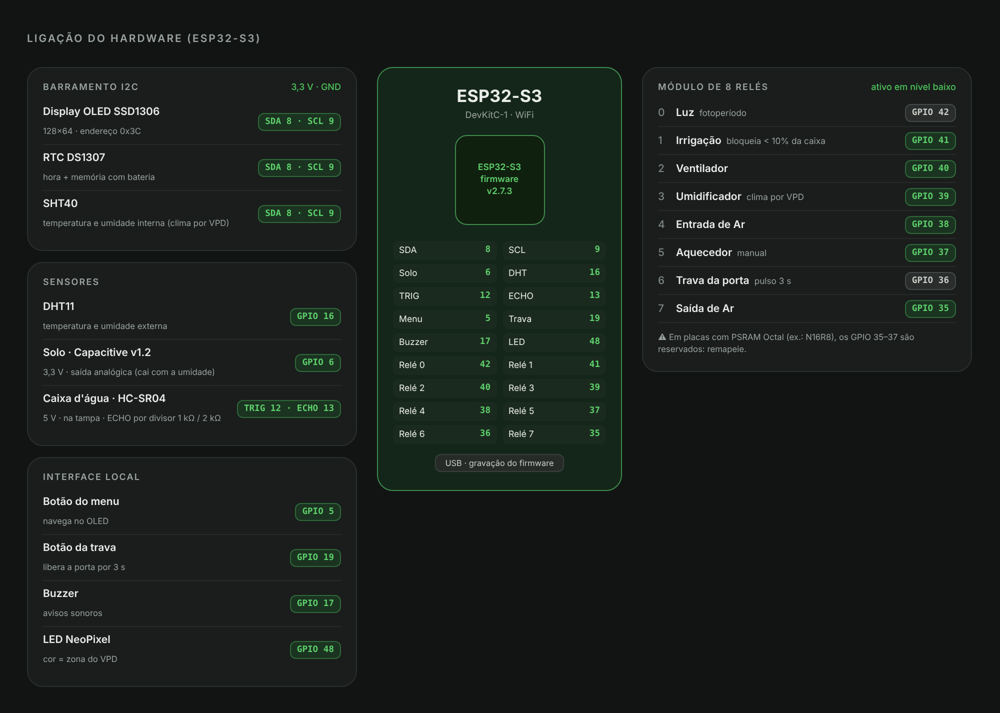

**Calibre no seu hardware** (em `src/main.cpp`):

| Ajuste | Para quê |
|---|---|
| `SOLO_MV_SECO` / `SOLO_MV_UMIDO` | Sensor de solo **capacitivo v1.2**: milivolts no ar e na água (veja "Solo - mV" no monitor serial) |
| `AGUA_SENSOR_ATE_FUNDO_CM` | Caixa d'água: distância da face do **HC-SR04** até o fundo (35 cm com o sensor na tampa) |
| `CAIXA_COMPRIMENTO_CM` / `CAIXA_LARGURA_CM` / `CAIXA_CAPACIDADE_L` | Medidas da caixa de paredes retas (66 × 36 × 35 cm, 70 L = 100%; 2,376 L por cm de água) |
| `MARGEM_ACAO_FRACAO` / `MARGEM_URGENTE_FRACAO` | Clima por VPD: onde o umidificador liga e desliga dentro da faixa (25%) e onde age na hora (10% das bordas) |
| `RELE_ATIVO_EM_BAIXO` | Troque para `false` se os relés ligarem invertidos |
| `WOKWI_SIMULATION` | `0` no hardware, `1` no simulador Wokwi |

**Sensores:**
- **Solo — Capacitive Soil Moisture Sensor v1.2:** VCC em 3,3 V, GND e AOUT no **GPIO6**. A saída cai com a umidade (~2,7 V no ar, ~1,1 V na água). Enterre só até a linha branca da placa.
- **Temperatura e umidade interna — SHT40:** é a leitura usada pelo clima por VPD. Deixe o sensor longe da saída de névoa do umidificador.
- **Caixa d'água — HC-SR04:** na tampa, virado para a água. VCC em **5 V**, GND, TRIG no **GPIO12** e ECHO no **GPIO13** por um **divisor de tensão** (ECHO → 1 kΩ → GPIO13 → 2 kΩ → GND), porque o ECHO sai em 5 V. Mede a cada 10 s (mediana de 5 medições, com compensação de temperatura). Com a caixa cheia (70 L = 29,5 cm de água), a superfície fica a ~5,5 cm do sensor, fora da zona cega de 3 cm. **Proteção da bomba:** com a caixa abaixo de 10%, o ESP32 desliga a irrigação e recusa ligá-la (pelo painel ou pelo OLED) até reabastecer.

---

## Clima por VPD

Roda no próprio ESP32, então continua funcionando sem internet. Você escolhe a fase no card **Clima por VPD** (Comandos), e o umidificador (relé 3) mantém o VPD **sempre dentro da faixa** dessa fase:

| Ponto | Onde fica | Floração (1,20–1,60) |
|---|---|---|
| Liga | 25% da largura da faixa abaixo do máximo | 1,50 |
| Desliga | 25% da largura acima do mínimo | 1,30 |
| Liga na hora | 10% abaixo do máximo, sem confirmação nem tempo mínimo | 1,56 |
| Desliga na hora | 10% acima do mínimo, respeitando só 1 min desde a última troca | 1,24 |

- **Contra o liga/desliga curto:** usa a média de 1 minuto sem os extremos (picos de névoa no sensor não contam), espera a condição se manter por 30 s e respeita o tempo mínimo ligado e desligado (padrão 3 min).
- **Segurança:** a trava de umidade e a falta de leitura do sensor desligam o umidificador na hora.
- **Só o umidificador age:** o aquecedor é um relé comum, só manual. Por isso o clima consegue **baixar** o VPD, mas não subir: se o ar ficar úmido demais por conta própria, o VPD pode ficar abaixo do mínimo.
- **Faixa estreita, mais ciclos:** numa faixa de 0,16 kPa (cerca de 5% de umidade), o umidificador liga e desliga com mais frequência para não sair dela.
- Cada ação gera um evento `clima_leitura` com o VPD, a temperatura, a umidade e o motivo, que aparece no Relógio de eventos.

---

## Painel ao vivo

Funciona só com a Hostinger, sem nenhuma configuração extra:

- **Estado a cada 5 s:** o ESP32 manda as leituras, a fase, o modo da luz e os relés para o `estado_atual.php`. O servidor guarda **só o último** (tabela `estado_atual`, uma linha), então o banco não cresce. O histórico continua com uma leitura por minuto.
- **Painel a cada 5 s:** a atualização automática chama o `ao_vivo.php`, que devolve o status, o estado atual e os ids do que mudou. O painel só busca leituras novas ou eventos quando há algo novo. Uma mudança no ESP32 aparece no painel em até ~10 s (5 s em média), e o selo do Início mostra **Online · ao vivo**.
- **Offline rápido:** se o ESP32 parar de mandar o estado e o banco ficar 90 s sem leitura, o painel mostra **Offline** sem esperar o tempo de "Dispositivo sem dados".
- **Leve para o ESP32:** o envio usa a mesma conexão HTTPS, que fica aberta, numa tarefa no núcleo 0. Sensores, relés, OLED e clima por VPD não esperam a rede.

**Recuperação automática da conexão:** o Wi-Fi pode continuar conectado sem os dados chegarem ao servidor (roteador sem internet, DNS, comunicação travada). Por isso, o ESP32 vigia a última resposta do servidor:
- **3 min** sem resposta: derruba e reconecta o Wi-Fi (repete a cada 3 min);
- **10 min** sem resposta: reinicia o ESP32 (fase, luz e relés manuais voltam da memória);
- comunicação **travada por 2 min**: reinicia o ESP32.

Depois de 3 reinícios seguidos sem resposta (servidor fora do ar), ele só reinicia a cada 1 h. Com o Wi-Fi realmente fora do ar, ele só tenta reconectar, sem reiniciar. Cada recuperação aparece em **Dispositivo → Atividade recente**. A cada minuto, o monitor serial mostra uma linha "Rede:" com a última resposta do servidor e a memória livre, para diagnóstico.

**Depois de uma falta de energia:** o ESP32 guarda relés manuais, fase, horários de luz e o último estado da luz na **flash** (não depende de bateria), além da memória do relógio (RTC). Ao ligar, a luz começa como estava e é decidida pelo horário logo no início, sem esperar o Wi-Fi. Se o relógio parou por falta de bateria, a luz fica como estava até o NTP trazer a hora certa (no máximo 10 min). Mesmo assim, troque a bateria do módulo do relógio se o monitor serial mostrar "RTC parado (sem bateria?)": sem ela, ele perde a hora a cada queda de energia.

**Fase e horários de luz no painel depois de um reinício:** ao ligar, ele informa ao painel a fase e os horários que recuperou. Se forem diferentes do que está salvo no painel (memória zerada), o servidor reenvia os do painel em segundos, sem reiniciar a contagem de dias da fase.

Na atualização da versão anterior, a migração `009` cria a tabela e passa a "Atualização automática" de 1 min ou mais para 5 s. Dá para mudar em **Configurações**.

---

## Instalação

### 1. Servidor (Hostinger)
1. Crie um banco MySQL no hPanel e importe `hostinger/sql/schema.sql` no phpMyAdmin.
2. Copie `hostinger/config.example.php` para `config.php` e preencha o banco, a `API_KEY` e o login do administrador. Para gerar o hash da senha:
   `php -r "echo password_hash('SUA_SENHA', PASSWORD_DEFAULT), PHP_EOL;"`
3. Envie o conteúdo da pasta `hostinger/` para o `public_html`, **incluindo a pasta `sql/`**. O site precisa de **HTTPS**.
4. No hPanel → **Avançado → Cron Jobs**, crie um cron **a cada minuto**:
   `php /home/SEU_USUARIO/domains/SEU-DOMINIO/public_html/cron.php`
5. Entre com o administrador. Para liberar o cadastro de outras pessoas, gere um código de convite em **Configurações → Usuários**.
6. (Opcional) Para os avisos no Telegram, acrescente `const TELEGRAM_BOT_TOKEN = '...';` no `config.php` e conecte o chat em **Configurações → Notificações**.

**Atualizando de uma versão anterior:** envie os arquivos novos e abra o painel uma vez. As migrações de `sql/migracoes/` são aplicadas sozinhas. Cada uma tem um `.down.sql` para desfazer pelo phpMyAdmin.

### 2. Firmware (ESP32-S3)
1. Copie `src/secrets.example.h` para `src/secrets.h`. Preencha o endereço do site e a mesma `API_KEY` do `config.php`. O Wi-Fi é opcional.
2. Abra o projeto no **VS Code + PlatformIO**, conecte a placa **pelo cabo USB** e clique em **Upload** (ambiente `esp32-s3-devkitc-1`).
3. **Vincule ao painel:**
   1. No painel, clique em **Dispositivo → Gerar token de vinculação**.
   2. Conecte o celular à rede **SmartDemetra-Setup** e abra **192.168.4.1**.
   3. Escolha a sua rede, confira o endereço do painel e cole o código.
   
   O ESP32 recebe um token próprio (`sd_hw_…`), e a partir daí a `API_KEY` deixa de ser aceita. Sem Wi-Fi no `secrets.h`, o portal abre sozinho. Com Wi-Fi, segure o botão do OLED por 3 s ao ligar.

O firmware antigo continua funcionando com o painel novo, usando a `API_KEY`, até ser atualizado.

### Simulação (opcional)
Com `WOKWI_SIMULATION 1` e o SSID `Wokwi-GUEST` no `secrets.h`, o projeto roda no simulador [Wokwi](https://wokwi.com) pela extensão do VS Code. Os arquivos `diagram.json` e `wokwi.toml` já estão incluídos. No simulador, o portal Wi-Fi não abre.

### 3. Conferir
O roteiro em [`docs/verificacao-manual.md`](docs/verificacao-manual.md) diz, página por página, o que abrir, o que clicar e o que deve aparecer.

---

## Referência técnica

<details>
<summary><b>Estrutura de pastas</b></summary>

```
├── src/
│   ├── main.cpp                 # firmware (v2.9.0)
│   └── secrets.example.h        # modelo de credenciais (copie para secrets.h)
├── hostinger/                   # painel + API (vai para o public_html)
│   ├── index.php                # painel (todas as páginas)
│   ├── partials/                # cabeçalho e rodapé comuns
│   ├── img/                     # símbolo da marca (logo.png), ícones do app e favicons
│   ├── fonts/                   # Demetra Display (só o nome Smart Demetra)
│   ├── login.php / logout.php   # acesso e cadastro
│   ├── auth.php                 # contas, "lembrar de mim", convite, CSRF, limite de tentativas
│   ├── usuarios.php             # senha e gestão de contas
│   ├── configuracoes.php        # preferências, faixas e status do timer
│   ├── ao_vivo.php              # atualização leve do painel (status, estado atual e ids do que mudou)
│   ├── estado_atual.php         # ESP32 manda o estado atual a cada 5 s (guarda só o último)
│   ├── fotoperiodo.php          # troca de fase (agora ou programada)
│   ├── dispositivo.php          # token do hardware, vinculação e atividade
│   ├── vincular.php             # ESP32 troca o código de vinculação pelo token
│   ├── notificacoes.php         # Telegram: conexão, teste e interruptores
│   ├── telegram.php             # envio, limite de 30 min e "normalizado"
│   ├── exportar_csv.php         # histórico em CSV
│   ├── cron.php                 # tarefas a cada minuto (linha de comando)
│   ├── migracoes.php            # funções comuns e atualização do banco
│   ├── api_comum.php            # início comum dos endpoints JSON (erros em JSON, config, login)
│   ├── dados.php / comandos.php
│   ├── enviar_comando.php / comandos_pendentes.php
│   ├── registrar_leitura.php / registrar_comando.php
│   ├── config.example.php       # modelo de configuração (copie para config.php)
│   └── sql/
│       ├── schema.sql           # instalação nova
│       └── migracoes/           # 002 a 009 (.up.sql automático, .down.sql manual)
├── docs/
│   ├── img/                     # imagens deste README e ícone
│   └── verificacao-manual.md    # roteiro de testes por página
├── platformio.ini
└── diagram.json, wokwi.toml     # simulação Wokwi
```
</details>

<details>
<summary><b>Endpoints da API</b></summary>

| Arquivo | Acesso | Função |
|---|---|---|
| `index.php`, `configuracoes.php`, `usuarios.php`, `enviar_comando.php` | Sessão (login) | Painel, preferências, contas e envio de comandos |
| `fotoperiodo.php`, `notificacoes.php`, `exportar_csv.php` | Sessão | Troca de fase, Telegram e CSV |
| `ao_vivo.php` | Sessão | Atualização leve: status, estado atual, última leitura e os ids mais recentes de leituras e eventos |
| `dispositivo.php` | Sessão (alterações só para admin) | Token do hardware, vinculação e atividade recente |
| `dados.php`, `comandos.php` | Sessão | Leituras para os gráficos e eventos (`dados.php?periodo=24h&desde=<id>` devolve só as leituras novas) |
| `registrar_leitura.php`, `registrar_comando.php`, `comandos_pendentes.php`, `estado_atual.php` | `X-API-Key` (token `sd_hw_` ou `API_KEY`) | Leituras, eventos, fila e estado atual do ESP32 |
| `vincular.php` | Código de vinculação (uso único) | Entrega o token definitivo ao ESP32 |
| `cron.php` | Só linha de comando | Trocas programadas, offline, timer e resumo diário |

**Comandos aceitos na fila:**
- `rele`: ligado ou desligado.
- `modo_cultivo`: vegetativo ou floracao.
- `luz_manual`: auto, ligada ou desligada.
- `luz_duracao`: 15, 30, 60 ou 120 min.
- `acesso`: liberar.
- `fotoperiodo`: `HH:MM`, em passos de 15 min.
- `clima_vpd`: `ativa;fase;min;max;travaTemp;travaUmid;minLigado;minDesligado` (fase: 0 muda, 1 vegetação, 2 floração; tempos em minutos). Exemplo: `1;2;1.20;1.60;28.0;60;3;3`. O formato antigo, sem os dois tempos, também é aceito. O `travaTemp` é mantido só por compatibilidade.

**Token do ESP32:**
- Enquanto nenhum token for gerado, vale a `API_KEY` do `config.php` (modo compatível).
- Depois da vinculação ou de "Gerar novo", só o token `sd_hw_` é aceito.
- "Revogar" bloqueia os dois.
</details>

<details>
<summary><b>Banco de dados</b></summary>

| Tabela | Conteúdo |
|---|---|
| `leituras_ambiente` | Leituras dos sensores + VPD e nível da caixa d'água (distância, litros e percentual) |
| `comandos_sistema` | Eventos do ESP32 e do painel (relés, timers, fases, alertas, avisos) |
| `comandos_pendentes` | Fila painel → ESP32 |
| `estado_atual` | Último estado enviado pelo ESP32 (a cada 5 s, uma linha só) |
| `configuracoes` | Horários de luz, fase e início do ciclo, faixas, Telegram e preferências |
| `trocas_fase` | Trocas de fase programadas |
| `dispositivos` | Firmware, sinal, último contato e hash do token do ESP32 |
| `notificacoes_estado` | Último aviso de cada tipo (limite de 30 min e "normalizado") |
| `usuarios` / `lembrar_tokens` | Contas e sessões "lembrar de mim" |
| `login_falhas` | Tentativas erradas (login, convite, senha e vinculação) |
| `migracoes_aplicadas` | Migrações já aplicadas |

Bancos de versões anteriores são atualizados sozinhos no primeiro acesso ao painel.
</details>

<details>
<summary><b>Memória do ESP32, hora e histórico local</b></summary>

- **Flash (NVS "estado"):** cópia de tudo o que vai para a memória do RTC (relés, modo, override, horários e duração da luz) e o último estado da luz. É de onde o ESP32 restaura ao ligar; a flash só é gravada quando o valor muda.
- **Memória do RTC DS1307** (reserva; só se mantém com a bateria do módulo):
  - bytes 0–7: relés, modo e override da luz (marcador `0xA6`; a memória gravada por firmware anterior à 2.6.3 é convertida sozinha para a nova posição do umidificador e da irrigação);
  - bytes 8–12: horários de início da luz;
  - bytes 13–14: duração do modo manual.
  
  A trava nunca volta ligada depois de um reinício.
- **Memória NVS:** rede Wi-Fi, endereço do painel e token `sd_hw_` salvos pelo portal. Esses valores têm prioridade sobre o `secrets.h`. A configuração do clima por VPD (fase, faixa, trava e tempos mínimos) também fica salva e volta ao ligar.
- **Hora:** NTP (`pool.ntp.org`, `time.google.com`, `a.st1.ntp.br`, `time.windows.com`), com o RTC como reserva. Fuso UTC−3.
- **Watchdog:** se o `loop()` parar por mais de 15 s (ex.: barramento I2C travado), o ESP32 reinicia e avisa em Dispositivo → Atividade recente.
- **Prazos:** todos os tempos com `millis()` usam a diferença com sinal, que continua certa quando o contador volta a zero (a cada 49,7 dias).
</details>

<details>
<summary><b>Dependências</b></summary>

- **Firmware** (instaladas pelo PlatformIO): Adafruit GFX, Adafruit SSD1306, RTClib, DHT sensor library, Adafruit NeoPixel, Adafruit SHT4x, ArduinoJson 7 e WiFiManager.
- **Painel:** Chart.js e Lucide (ícones), carregados via CDN.
- **Servidor:** PHP 8 com PDO MySQL e cURL (para o Telegram).
</details>

<details>
<summary><b>Limitações conhecidas</b></summary>

- **Atualização de firmware pelo painel (OTA):** não implementada. O firmware é gravado pelo cabo USB.
- **"Esqueci a senha" por e-mail:** não existe. O administrador gera uma senha temporária.
- **Irrigação automática:** não implementada. A irrigação é ligada manualmente (painel ou OLED) e só é bloqueada pela proteção da caixa d'água.
- **Clima por VPD só baixa o VPD:** sem desumidificador nem aquecimento automático, ele não consegue subir o VPD quando o ar fica úmido demais.
</details>

---

Uso pessoal/educacional. Adapte livremente ao seu cultivo.
