# 🌿 Smart Demetra — automação de cultivo indoor (ESP32-S3)

Controla a **luz**, a **ventilação**, a **umidificação**, o **aquecimento**, a **irrigação** e a **trava da porta** de uma estufa. Mede **temperatura, umidade, solo e VPD**, avisa pelo **Telegram** quando algo sai da faixa e mostra tudo num **painel web** que funciona no computador e no celular.

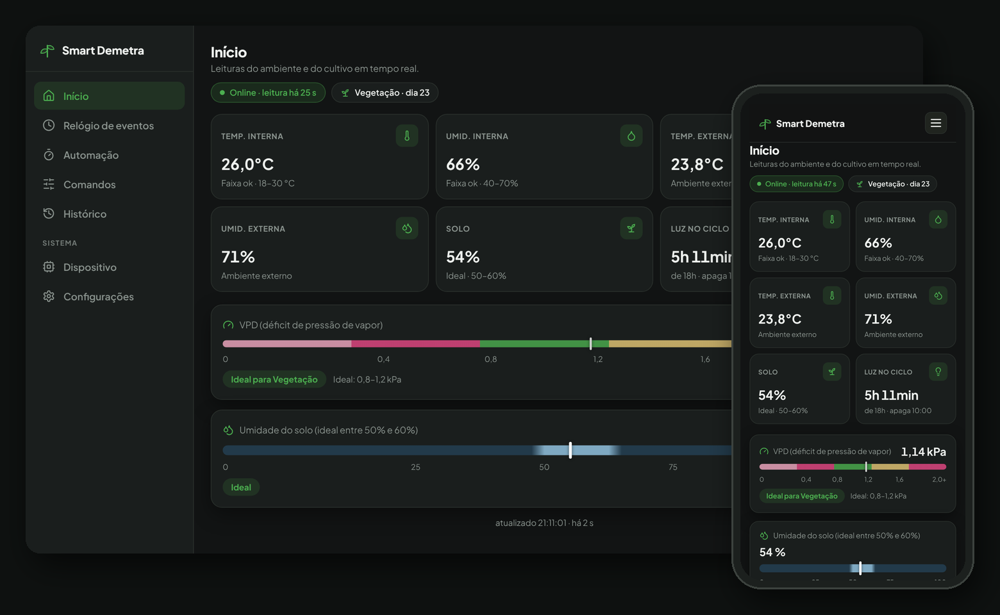

> **Versão atual:** painel v2 · firmware **v2.4.0** · banco com migrações automáticas até a `006`.

---

## O que o projeto faz

- 💡 **Luz automática por fase** — Vegetação 18/6 h ou floração 12/12 h. Você escolhe só a hora em que a luz acende, e o ESP32 confirma o horário em uso.
- 🌱 **Ciclo de cultivo** — Conta o dia do ciclo e troca de fase na hora ou numa data programada.
- 🌡️ **Monitoramento** — Temperatura e umidade dentro e fora da estufa, umidade do solo e VPD avaliado pela fase ativa, gravados a cada minuto.
- 🔔 **Avisos no Telegram** — Leitura fora da faixa, dispositivo offline, timer não confirmado e resumo diário às 08:00.
- 🌀 **8 relés** — Luz, umidificador, ventilador, irrigação, entrada de ar, aquecedor, saída de ar e trava da porta.
- 🔐 **Acesso seguro** — Várias contas com código de convite, limite de tentativas e token próprio para o ESP32.
- 📶 **Configuração sem cabo** — Portal Wi-Fi **SmartDemetra-Setup** para escolher a rede e vincular o aparelho ao painel.
- 🖥️ **Uso local** — Display OLED e botões no aparelho, que continuam funcionando sem internet.
- 🔋 **Sem perder estado** — Relés, fase, horários e duração do modo manual ficam na memória do relógio (RTC), mesmo se faltar energia.

---

## Como funciona

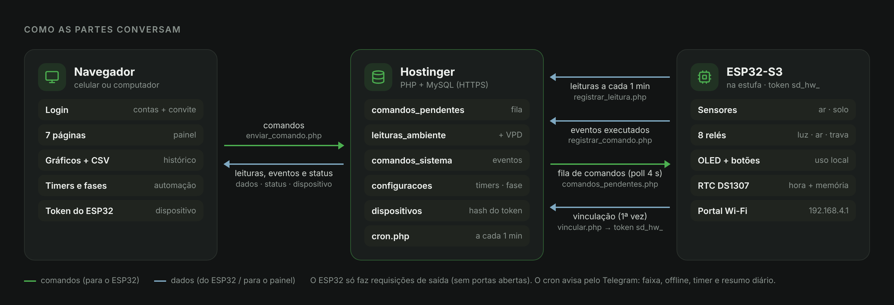

1. O **ESP32** lê os sensores e envia uma leitura por minuto para o servidor na **Hostinger**, identificado pelo seu **token do hardware**.
2. No **painel**, cada ação grava um comando numa **fila** no banco de dados.
3. O ESP32 consulta essa fila a cada **4 segundos**, aplica o comando e confirma de volta. O painel mostra se a confirmação chegou.
4. Um **cron** roda no servidor a cada minuto. Ele faz as trocas de fase programadas e envia os avisos do Telegram.

O ESP32 só faz requisições de saída, então não é preciso abrir portas no roteador e o painel funciona de qualquer lugar.

---

## O painel

### Início
Mostra as leituras atuais com a faixa ideal de cada card e o selo **Online/Offline** com o tempo da última leitura. O selo da fase indica o **dia do ciclo**. O card **Luz no ciclo** mostra há quanto tempo a luz está acesa. O VPD é comparado com a faixa da fase ativa, e o solo tem a faixa ideal marcada.
Se o ESP32 parar de enviar, aparece o aviso de offline com a hora da última leitura. Se o sensor de solo enviar 0% três vezes seguidas, o card mostra **"Sensor sem leitura"**.

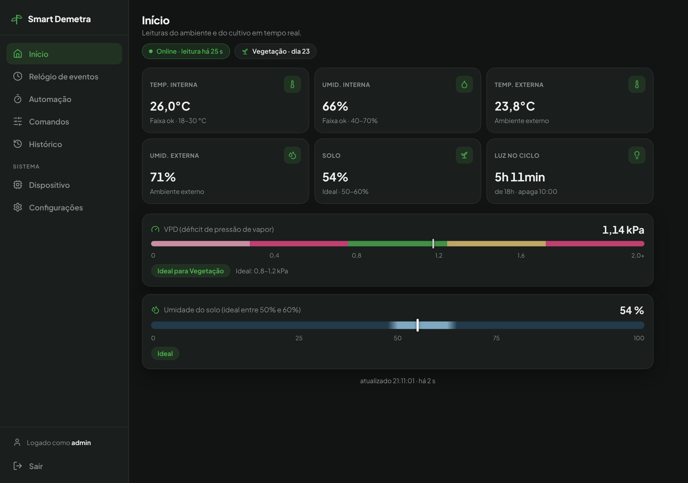

### Relógio de eventos
As últimas 24 horas num relógio. A faixa de luz segue o fotoperíodo da fase ativa (18/6 na vegetação, 12/12 na floração). O aquecedor e o umidificador têm anéis próprios: cada trecho pintado é um período ligado, com a leitura do sensor e a regra da automação no detalhe. Porta, avisos, trocas de fase e ajustes das automações aparecem como pontos. No topo, um resumo das 24h que também filtra; embaixo, a lista separada em Hoje e Ontem.

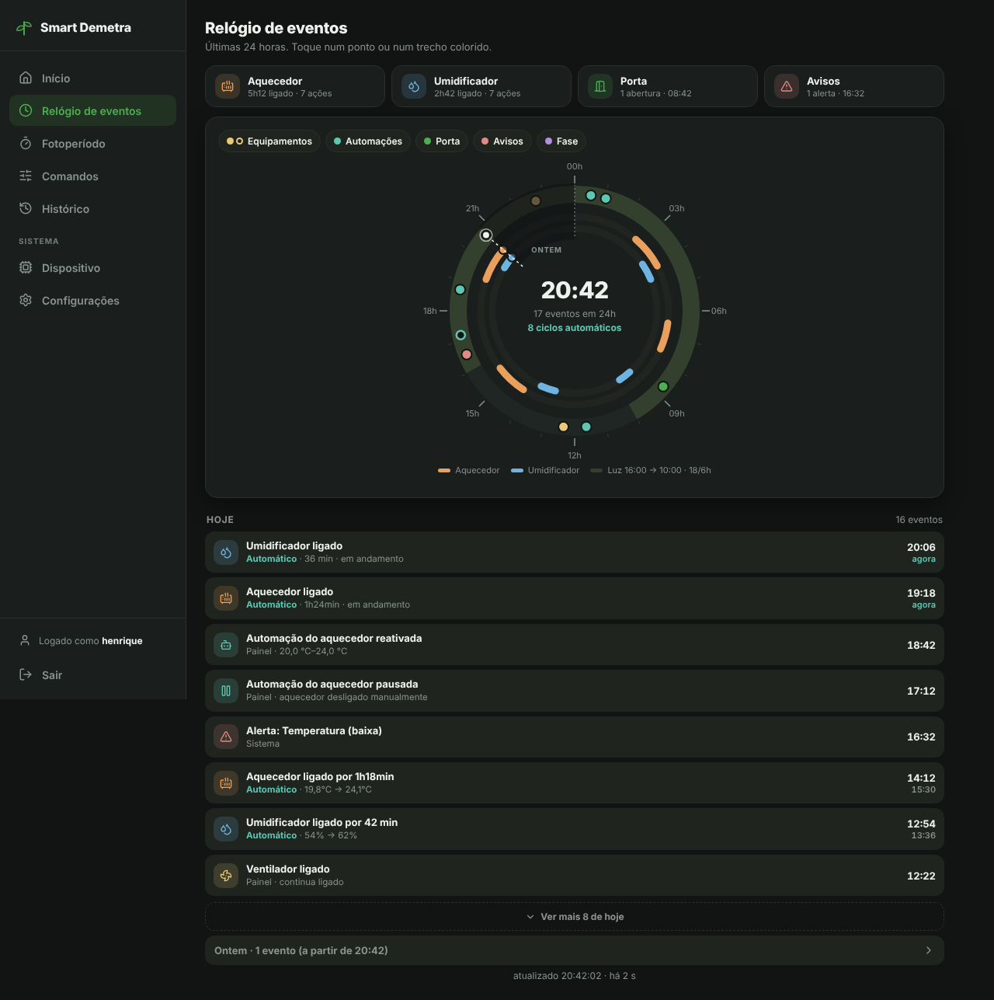

### Fotoperíodo
É a central dos timers e da fase:

- **Quatro cards de resumo:** fase ativa com o dia do ciclo, luz agora, próxima mudança e **Timer no ESP32**. Este último mostra se o timer está confirmado, aguardando ou divergente.
- **Card de cada fase:** você escolhe a hora em que a luz acende, e a hora de apagar é calculada mantendo 18/6 ou 12/12.
- **Fase inativa:** tem a seção **Troca de fase**, para ativar agora ou programar uma data. A troca acontece no primeiro horário de luz desse dia.

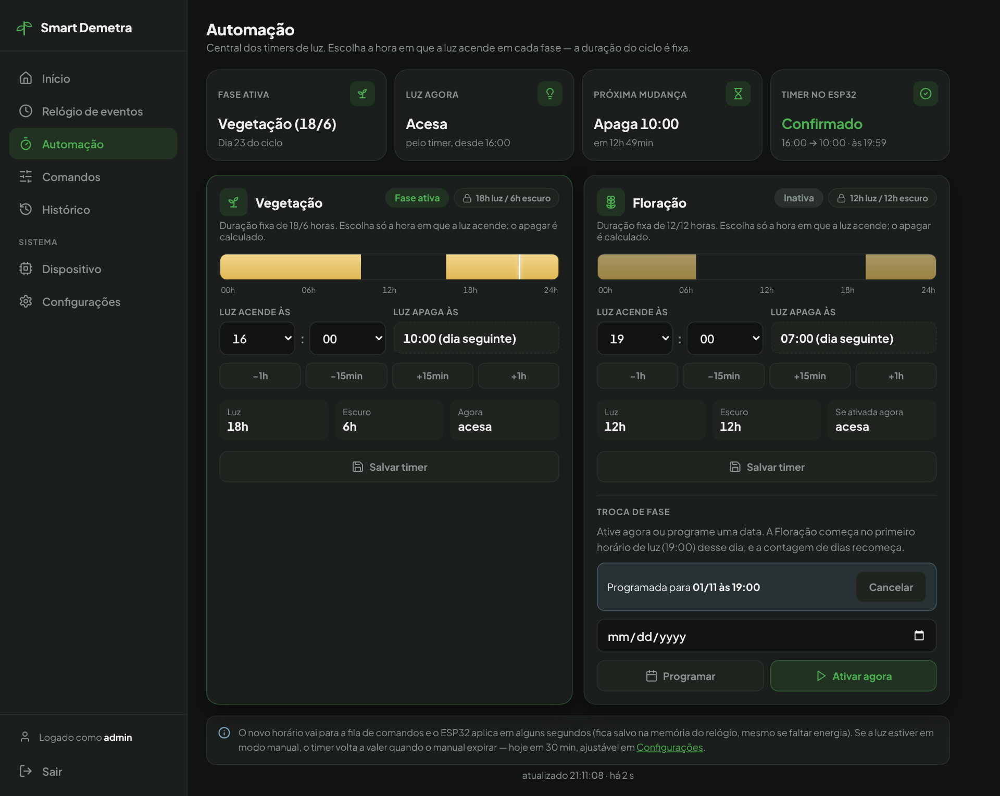

### Comandos
Modo de cultivo, automações do aquecedor e do umidificador, luz automática ou manual, liberação da porta e interruptores dos relés. Cada interruptor mostra o estado real e há quanto tempo está assim. A troca de fase fica no Fotoperíodo.

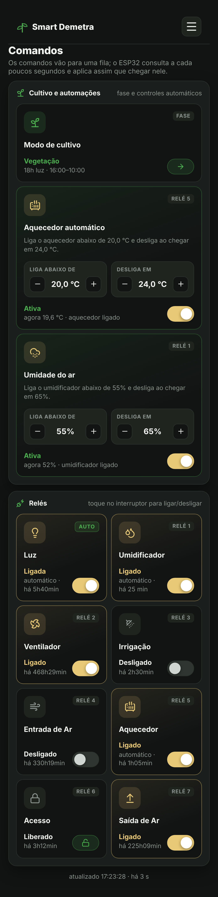

### Histórico e VPD
Gráficos de temperatura, umidade, solo e **VPD** em 24 h, 7 dias ou 30 dias. O botão **Exportar CSV** baixa o período escolhido, com o estado da luz. O CSV usa `;` e vírgula decimal e abre direto no Excel em português.

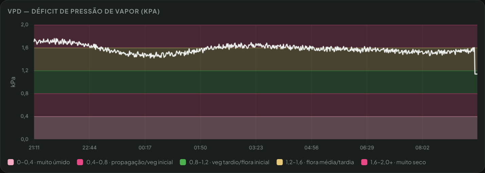

| VPD (kPa) | Zona | Cor |
|---|---|---|
| < 0,4 | Muito úmido (risco de fungo) | Rosa fraco |
| 0,4 – 0,8 | Propagação / vegetativo inicial | Rosa forte |
| 0,8 – 1,2 | Ideal na vegetação (padrão) | Verde |
| 1,2 – 1,6 | Ideal na floração (padrão) | Amarelo |
| > 1,6 | Muito seco (estresse hídrico) | Rosa forte |

As faixas ideais de cada fase podem ser ajustadas em Configurações.

### Dispositivo
- **Status do ESP32:** modelo, MAC, firmware, último contato, sinal Wi-Fi e tempo ligado.
- **Token do hardware:** o banco guarda só o hash, e o token completo aparece uma única vez. Os botões **Gerar novo** e **Revogar** pedem confirmação.
- **Vincular novo dispositivo:** gera um código de uso único, válido por 30 min, para colar no portal Wi-Fi do ESP32.
- **Atividade recente:** timer confirmado, reconexões, reinícios, troca de firmware e sensor de solo.

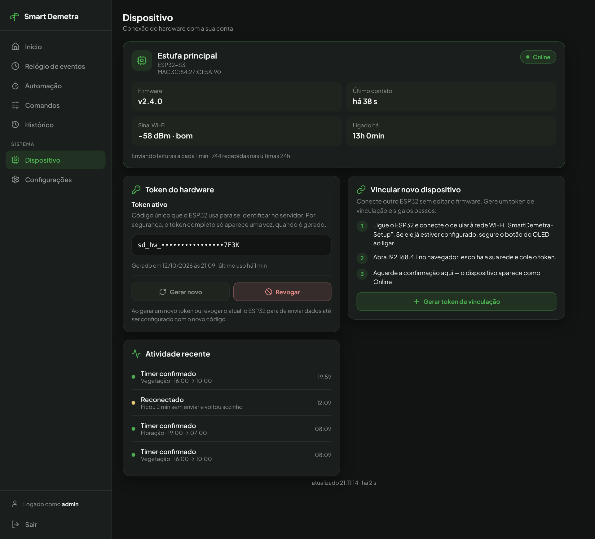

### Configurações
- **Painel:** nome do cultivo, página inicial, atualização automática (1, 2, 5 ou 10 min) e período padrão do histórico.
- **Faixas de alerta:** solo, temperatura e umidade interna (mínimo e máximo), VPD ideal por fase e o tempo para considerar o dispositivo sem dados. O servidor valida tudo e aceita vírgula decimal.
- **Notificações:** conexão com o Telegram, mensagem de teste e os quatro interruptores de aviso.
- **Luz:** duração do modo manual (15, 30, 60 ou 120 min). O valor é enviado ao ESP32, e o painel mostra quando ele aplicou.
- **Conta e usuários:** troca de senha. O administrador também gerencia o código de convite e as contas.

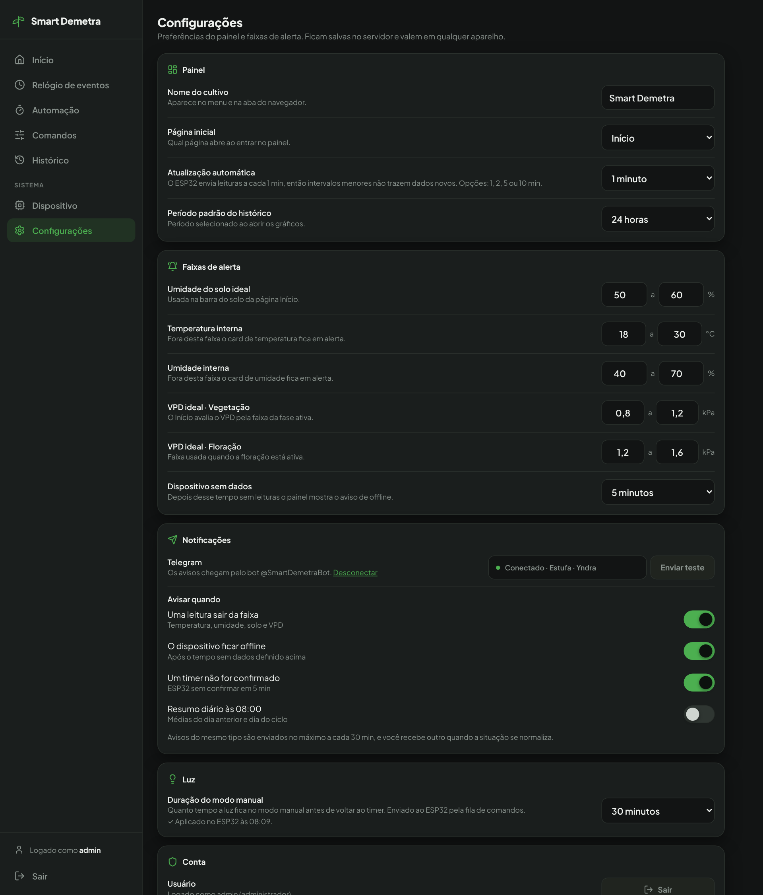

### No celular
O mesmo painel se adapta à tela do celular, com o menu recolhido no botão ☰.

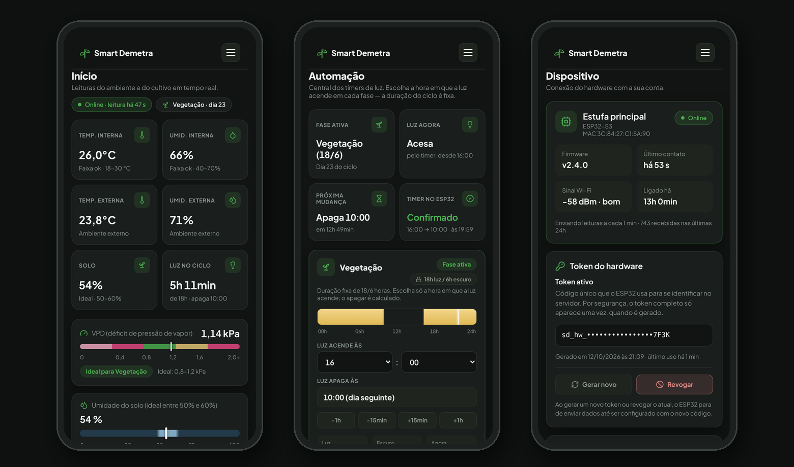

---

## Notificações pelo Telegram

| Aviso | Quando chega |
|---|---|
| Leitura fora da faixa | Temperatura, umidade, solo ou VPD saem da faixa (avaliado a cada leitura) |
| Dispositivo offline | Passou o tempo de "Dispositivo sem dados" sem leituras |
| Timer não confirmado | O ESP32 não confirmou o timer da fase ativa em 5 min, ou usa um horário diferente |
| Resumo diário | Às 08:00: médias do dia anterior e dia do ciclo (desligado por padrão) |

Cada tipo de aviso chega no máximo uma vez a cada 30 min. Quando a situação volta ao normal, chega um aviso de **"normalizado"**. Todos os envios ficam registrados no Relógio de eventos.

Para conectar: crie um bot no **@BotFather** e coloque o token no `config.php`. Depois clique em **Configurações → Notificações → Conectar**, abra o link no celular e toque em **Iniciar**.

---

## Acesso e contas

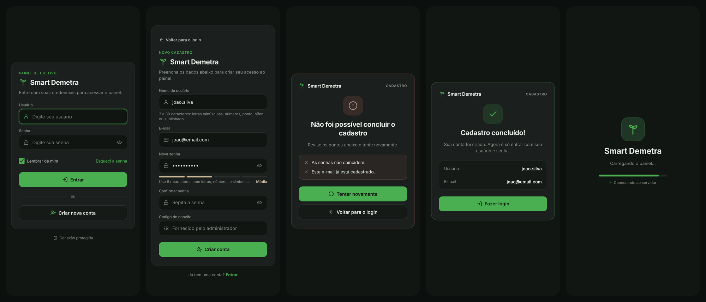

- **Login** com usuário ou e-mail e a opção **Lembrar de mim**, que vale 30 dias.
- **Cadastro** protegido por **código de convite**, que o administrador gera em Configurações → Usuários. Sem código, ninguém consegue se cadastrar.
- **Administrador principal:** é o usuário do `config.php`. No primeiro acesso ele vira uma conta no banco, e a senha pode ser trocada no painel. Se esquecer a senha, gere um hash novo no `config.php`: ele volta a valer.
- **Esqueci a senha:** o administrador gera uma senha temporária, e a pessoa troca depois em Configurações.
- **Alterar senha** desconecta os outros aparelhos, inclusive os que usam "Lembrar de mim".
- **Limite de tentativas:** 5 erros para o mesmo usuário, ou 20 erros de um mesmo IP, bloqueiam novas tentativas por 15 minutos.
- Os formulários são protegidos contra CSRF, e as senhas e tokens ficam só como hash no banco.

---

## Hardware

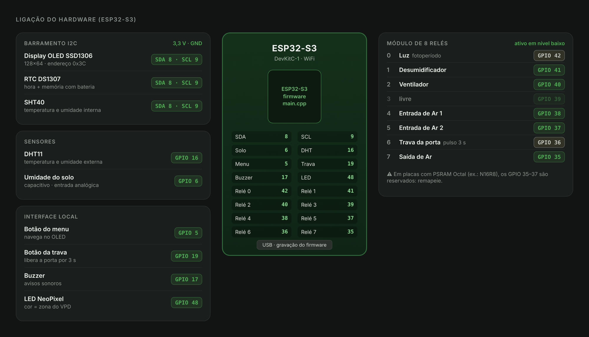

**Calibre no seu hardware** (em `src/main.cpp`):

| Ajuste | Para quê |
|---|---|
| `SOLO_ADC_SECO` / `SOLO_ADC_UMIDO` | Leitura bruta do sensor de solo no ar e na água |
| `RELE_ATIVO_EM_BAIXO` | Troque para `false` se os relés ligarem invertidos |
| `WOKWI_SIMULATION` | `0` no hardware, `1` no simulador Wokwi |

O relé 3 (GPIO39) está livre. O projeto não tem bomba de irrigação.

---

## Instalação

### 1. Servidor (Hostinger)
1. Crie um banco MySQL no hPanel e importe `hostinger/sql/schema.sql` no phpMyAdmin.
2. Copie `hostinger/config.example.php` para `config.php` e preencha o banco, a `API_KEY` e o login do administrador. Para gerar o hash da senha:
   `php -r "echo password_hash('SUA_SENHA', PASSWORD_DEFAULT), PHP_EOL;"`
3. Envie o conteúdo da pasta `hostinger/` para o `public_html`, **incluindo a pasta `sql/`**. O site precisa de **HTTPS**.
4. No hPanel → **Avançado → Cron Jobs**, crie um cron **a cada minuto**:
   `php /home/SEU_USUARIO/domains/SEU-DOMINIO/public_html/cron.php`
5. Entre com o administrador. Para liberar o cadastro de outras pessoas, gere um código de convite em **Configurações → Usuários**.
6. (Opcional) Para os avisos no Telegram, acrescente `const TELEGRAM_BOT_TOKEN = '...';` no `config.php` e conecte o chat em **Configurações → Notificações**.

**Atualizando de uma versão anterior:** envie os arquivos novos e abra o painel uma vez. As migrações de `sql/migracoes/` são aplicadas sozinhas. Cada uma tem um `.down.sql` para desfazer pelo phpMyAdmin.

### 2. Firmware (ESP32-S3)
1. Copie `src/secrets.example.h` para `src/secrets.h`. Preencha o endereço do site e a mesma `API_KEY` do `config.php`. O Wi-Fi é opcional.
2. Abra o projeto no **VS Code + PlatformIO**, conecte a placa **pelo cabo USB** e clique em **Upload** (ambiente `esp32-s3-devkitc-1`).
3. **Vincule ao painel:**
   1. No painel, clique em **Dispositivo → Gerar token de vinculação**.
   2. Conecte o celular à rede **SmartDemetra-Setup** e abra **192.168.4.1**.
   3. Escolha a sua rede, confira o endereço do painel e cole o código.
   
   O ESP32 recebe um token próprio (`sd_hw_…`), e a partir daí a `API_KEY` deixa de ser aceita. Sem Wi-Fi no `secrets.h`, o portal abre sozinho. Com Wi-Fi, segure o botão do OLED por 3 s ao ligar.

O firmware antigo continua funcionando com o painel novo, usando a `API_KEY`, até ser atualizado.

### Simulação (opcional)
Com `WOKWI_SIMULATION 1` e o SSID `Wokwi-GUEST` no `secrets.h`, o projeto roda no simulador [Wokwi](https://wokwi.com) pela extensão do VS Code. Os arquivos `diagram.json` e `wokwi.toml` já estão incluídos. No simulador, o portal Wi-Fi não abre.

### 3. Conferir
O roteiro em [`docs/verificacao-manual.md`](docs/verificacao-manual.md) diz, página por página, o que abrir, o que clicar e o que deve aparecer.

---

## Referência técnica

<details>
<summary><b>Estrutura de pastas</b></summary>

```
├── src/
│   ├── main.cpp                 # firmware (v2.4.0)
│   └── secrets.example.h        # modelo de credenciais (copie para secrets.h)
├── hostinger/                   # painel + API (vai para o public_html)
│   ├── index.php                # painel (todas as páginas)
│   ├── partials/                # cabeçalho e rodapé comuns
│   ├── login.php / logout.php   # acesso e cadastro
│   ├── auth.php                 # contas, "lembrar de mim", convite, CSRF, limite de tentativas
│   ├── usuarios.php             # senha e gestão de contas
│   ├── configuracoes.php        # preferências, faixas e status do timer
│   ├── status.php               # online/offline e dados do ESP32
│   ├── fotoperiodo.php          # troca de fase (agora ou programada)
│   ├── dispositivo.php          # token do hardware, vinculação e atividade
│   ├── vincular.php             # ESP32 troca o código de vinculação pelo token
│   ├── notificacoes.php         # Telegram: conexão, teste e interruptores
│   ├── telegram.php             # envio, limite de 30 min e "normalizado"
│   ├── exportar_csv.php         # histórico em CSV
│   ├── cron.php                 # tarefas a cada minuto (linha de comando)
│   ├── migracoes.php            # funções comuns e atualização do banco
│   ├── dados.php / comandos.php
│   ├── enviar_comando.php / comandos_pendentes.php
│   ├── registrar_leitura.php / registrar_comando.php
│   ├── config.example.php       # modelo de configuração (copie para config.php)
│   └── sql/
│       ├── schema.sql           # instalação nova
│       └── migracoes/           # 002 a 006 (.up.sql automático, .down.sql manual)
├── docs/
│   ├── img/                     # imagens deste README
│   └── verificacao-manual.md    # roteiro de testes por página
├── platformio.ini
└── diagram.json, wokwi.toml     # simulação Wokwi
```
</details>

<details>
<summary><b>Endpoints da API</b></summary>

| Arquivo | Acesso | Função |
|---|---|---|
| `index.php`, `configuracoes.php`, `usuarios.php`, `enviar_comando.php` | Sessão (login) | Painel, preferências, contas e envio de comandos |
| `status.php`, `fotoperiodo.php`, `notificacoes.php`, `exportar_csv.php` | Sessão | Status, troca de fase, Telegram e CSV |
| `dispositivo.php` | Sessão (alterações só para admin) | Token do hardware, vinculação e atividade recente |
| `dados.php`, `comandos.php` | Público (leitura) | Leituras para os gráficos e eventos |
| `registrar_leitura.php`, `registrar_comando.php`, `comandos_pendentes.php` | `X-API-Key` (token `sd_hw_` ou `API_KEY`) | Leituras, eventos e fila do ESP32 |
| `vincular.php` | Código de vinculação (uso único) | Entrega o token definitivo ao ESP32 |
| `cron.php` | Só linha de comando | Trocas programadas, offline, timer e resumo diário |

**Comandos aceitos na fila:**
- `rele`: ligado ou desligado.
- `modo_cultivo`: vegetativo ou floracao.
- `luz_manual`: auto, ligada ou desligada.
- `luz_duracao`: 15, 30, 60 ou 120 min.
- `acesso`: liberar.
- `fotoperiodo`: `HH:MM`, em passos de 15 min.

**Token do ESP32:**
- Enquanto nenhum token for gerado, vale a `API_KEY` do `config.php` (modo compatível).
- Depois da vinculação ou de "Gerar novo", só o token `sd_hw_` é aceito.
- "Revogar" bloqueia os dois.
</details>

<details>
<summary><b>Banco de dados</b></summary>

| Tabela | Conteúdo |
|---|---|
| `leituras_ambiente` | Leituras dos sensores + VPD |
| `comandos_sistema` | Eventos do ESP32 e do painel (relés, timers, fases, alertas, avisos) |
| `comandos_pendentes` | Fila painel → ESP32 |
| `configuracoes` | Horários de luz, fase e início do ciclo, faixas, Telegram e preferências |
| `trocas_fase` | Trocas de fase programadas |
| `dispositivos` | Firmware, sinal, último contato e hash do token do ESP32 |
| `notificacoes_estado` | Último aviso de cada tipo (limite de 30 min e "normalizado") |
| `usuarios` / `lembrar_tokens` | Contas e sessões "lembrar de mim" |
| `login_falhas` | Tentativas erradas (login, convite, senha e vinculação) |
| `migracoes_aplicadas` | Migrações já aplicadas |

Bancos de versões anteriores são atualizados sozinhos no primeiro acesso ao painel.
</details>

<details>
<summary><b>Memória do ESP32, hora e histórico local</b></summary>

- **Memória do RTC DS1307:**
  - bytes 0–7: relés, modo e override da luz;
  - bytes 8–12: horários de início da luz;
  - bytes 13–14: duração do modo manual.
  
  A trava nunca volta ligada depois de um reinício.
- **Memória NVS:** rede Wi-Fi, endereço do painel e token `sd_hw_` salvos pelo portal. Esses valores têm prioridade sobre o `secrets.h`.
- **Hora:** NTP (`pool.ntp.org`, `time.google.com`, `a.st1.ntp.br`, `time.windows.com`), com o RTC como reserva. Fuso UTC−3.
- **Histórico local:** CSV na memória interna (LittleFS) a cada 10 min, com os últimos 7 dias. O histórico completo fica no banco.
</details>

<details>
<summary><b>Dependências</b></summary>

- **Firmware** (instaladas pelo PlatformIO): Adafruit GFX, Adafruit SSD1306, RTClib, DHT sensor library, Adafruit NeoPixel, Adafruit SHT4x, ArduinoJson e WiFiManager.
- **Painel:** Chart.js e Lucide (ícones), carregados via CDN.
- **Servidor:** PHP 8 com PDO MySQL e cURL (para o Telegram).
</details>

<details>
<summary><b>Limitações conhecidas</b></summary>

- **Atualização de firmware pelo painel (OTA):** não implementada. O firmware é gravado pelo cabo USB.
- **"Esqueci a senha" por e-mail:** não existe. O administrador gera uma senha temporária.
- **Irrigação automática:** não implementada, porque não há bomba no hardware.
</details>

---

Uso pessoal/educacional. Adapte livremente ao seu cultivo.
